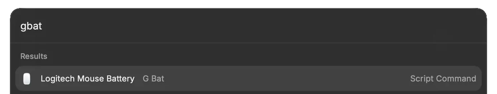

<p align="center">
  
</p>

<h1 align="center">gbat</h1>

<p align="center">
  <a href="README.md"><kbd>English</kbd></a>
  <a href="README.zh-CN.md"><kbd>简体中文</kbd></a>
</p>

`gbat` reads the battery level and charging state of a Logitech G Pro Wireless 2
on macOS and Linux, prints one line, and exits.

```text
Battery: 78%
Battery: 42% (charging)
```

Use it in Terminal, shell scripts, or Raycast. It does not require Logitech
G HUB, Python, or a background process.

## Requirements

- macOS 11 Big Sur or later, or Linux with hidraw and udev
- A Logitech G Pro Wireless 2 connected through its LIGHTSPEED receiver or USB
- A mouse that is awake when `gbat` runs

## Install

The Homebrew package and GitHub release archive support Apple Silicon only,
with an `arm64` binary. On Linux, [build from source](#build-from-source) and
[run battery queries with sudo](#linux-and-sudo). Raycast integration is macOS-only.

Install with Homebrew:

```sh
brew install softmaxe/tap/gbat
gbat --version
```

To upgrade:

```sh
brew upgrade gbat
```

To uninstall:

```sh
brew uninstall gbat
```

Release binaries have no Apple Developer ID signature or notarization. If macOS
blocks `gbat`, follow the steps in [Troubleshooting](#troubleshooting).

The [release workflow](.github/workflows/release.yml) publishes a SHA-256 checksum
and GitHub build provenance for each release archive. Find the archives on the
[releases page](https://github.com/softmaxe/gbat/releases). These checks do not
replace Apple code signing or notarization.

## Use

Connect the mouse through its LIGHTSPEED receiver or USB. On macOS, run:

```sh
gbat
```

On Linux, run the binary with `sudo` (see [why sudo is needed](#linux-and-sudo)):

```sh
sudo /path/to/gbat
```

On success, the command writes one battery status line to stdout and exits with
status `0`. On failure, it writes an error to stderr and exits with status `1`.
Run `gbat --version` to print the installed version without accessing the mouse;
this works without `sudo` on both platforms.

An idle mouse may take longer to answer while its radio wakes. If the receiver
reports that the mouse is offline, turn it on or move it, then retry.

<p align="center">
  
</p>

This terminal demo shows real battery readings from `gbat 0.0.1`. It is a
historical recording, so its version may differ from the current release.
See [recording details](docs/recording.md) for its source and update instructions.

## Raycast

[`raycast/mouse-battery.sh`](raycast/mouse-battery.sh) is a Raycast Script Command.
Homebrew installs the binary only. Download the script into a local directory,
then make it executable with `chmod +x /path/to/mouse-battery.sh`. You can also
use this repository's `raycast` directory. Add the script's directory in Raycast
Settings, then run `Logitech Mouse Battery`.

<p align="center">
  
</p>

The script checks `PATH`, `/opt/homebrew/bin`, `/usr/local/bin`,
`$HOME/.local/bin`, and the repository's `target/release` directory, in that
order.

For a custom binary path, add this line to `mouse-battery.sh` before
`set -euo pipefail`:

```sh
export GBAT_BINARY="/path/to/gbat"
```

Setting this variable in Terminal only affects scripts launched from that shell.

`GBAT_BINARY` takes priority over the search above and must point to an
executable file.

## Build from source

Install Rust through `rustup`. The repository pins its Rust version in
[`rust-toolchain.toml`](rust-toolchain.toml), and `rustup` installs that toolchain
when needed. Then clone and build:

```sh
git clone https://github.com/softmaxe/gbat.git
cd gbat
cargo build --release --locked
```

Run the built binary on macOS with `./target/release/gbat`, or on Linux with:

```sh
sudo ./target/release/gbat
```

To keep the binary outside the build directory:

```sh
mkdir -p "$HOME/.local/bin"
cp target/release/gbat "$HOME/.local/bin/gbat"
```

Make sure `$HOME/.local/bin` is on `PATH` to run `gbat` from any directory.
On Linux, use `sudo "$HOME/.local/bin/gbat"`; `sudo` may use a different `PATH`.

### Linux and sudo

Use `sudo` for battery queries on Linux:

```sh
sudo ./target/release/gbat
```

Linux exposes the receiver and mouse through `/dev/hidraw*`. These device nodes
are normally accessible only to root. Reading battery status requires opening
the appropriate node for both reading and writing: `gbat` sends a HID++ battery
query and receives the reply. Without sufficient permissions, opening the
device fails with `Permission denied (os error 13)`.

`sudo` grants the CLI the access it needs for that invocation. `gbat` does not
install udev rules, change device permissions or group membership, or configure
passwordless sudo. Build with `cargo` as your regular user and use `sudo` only
when running the binary to read the battery. `--version` needs no elevation.

The Linux CLI uses the native hidraw backend. It does not need `libudev-dev`,
`libusb`, or a separately installed HIDAPI library. A C compiler and linker are
still needed to build Rust dependencies (`sudo apt install build-essential`
on Ubuntu/Debian).

## Troubleshooting

| Problem | What to do |
| --- | --- |
| `No responsive Logitech HID++ interface found` | Connect the receiver or USB cable, wake the mouse, and retry. |
| `The receiver reports no connected mouse` | The mouse is offline. Turn it on or move it, and retry. |
| `Could not read battery level` | The mouse may have gone offline during the read, or its battery response could not be used. Move it and retry. |
| `Could not initialize HID access` or `Could not read battery level: HID access failed` on macOS | Run `gbat` once from Terminal and approve any macOS permission prompt. `sudo` is not normally required on macOS. |
| `Permission denied (os error 13)` on Linux | Run `sudo /path/to/gbat`; see [Linux and sudo](#linux-and-sudo). |
| `gbat binary not found` in Raycast | Install or build `gbat`, or set `GBAT_BINARY` in the script to its executable path. |
| `Battery: 100%` without `(charging)` | A full mouse may stop active charging. This is expected. |
| macOS blocks the binary | Open System Settings > Privacy & Security and choose Open Anyway for `gbat`. |

If Open Anyway does not work for a Homebrew installation, remove quarantine
from that formula only:

```sh
xattr -dr com.apple.quarantine "$(brew --prefix gbat)"
```

## How it works

`gbat` opens Logitech HID++ interfaces in shared mode on macOS and through hidraw
on Linux. It checks receiver device
indices `1` through `6` and the direct USB index `0xFF`, trying `1` and `0xFF`
first. It uses the first interface and device index that reports a supported
battery feature. It filters only by Logitech's vendor ID, so with several
Logitech HID++ devices connected it may read another mouse, keyboard, or
headset. There is no device selector.

It reads `UNIFIED_BATTERY` at `0x1004` and falls back to `BATTERY_STATUS` at
`0x1000` when the unified feature is unavailable, does not answer, or returns an
incomplete response. Once a battery feature is found, HID access errors stop the
read. During discovery, an interface that fails is skipped; its error is
reported only if no other interface finds the mouse or reports it offline.
If neither feature yields a battery status, the command reports an error
instead of inventing a `0%` reading.

## License

[GNU Affero General Public License v3](LICENSE), `AGPL-3.0-only`.
