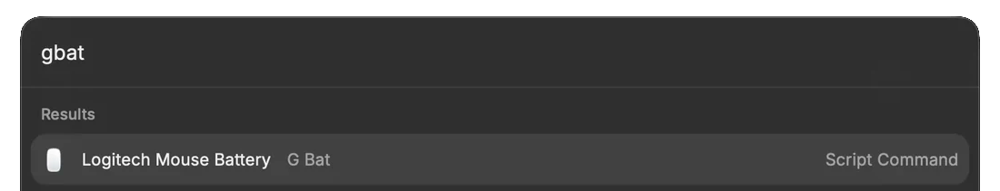

<p align="center">
  
</p>

<h1 align="center">gbat</h1>

<p align="center">
  <a href="README.md"><kbd>English</kbd></a>
  <a href="README.zh-CN.md"><kbd>简体中文</kbd></a>
</p>

`gbat` 在 macOS 和 Linux 上读取 Logitech G Pro Wireless 2 的电量和充电状态，输出一行结果后退出。

```text
Battery: 78%
Battery: 42% (charging)
```

可在 Terminal、Shell 脚本或 Raycast 中使用，不需要 Logitech G HUB、Python 或后台进程。

## 系统要求

- macOS 11 Big Sur 及以上版本，或支持 hidraw 和 sysfs 的 Linux
- 通过 LIGHTSPEED 接收器或 USB 连接的 Logitech G Pro Wireless 2
- 运行 `gbat` 时鼠标处于唤醒状态

## 安装

Homebrew 软件包和 GitHub Release 归档仅提供适用于 Apple Silicon 的 macOS `arm64` 可执行文件。Linux 用户请[从源码构建](#从源码构建)，并[使用 sudo 查询电量](#linux-设备权限)。Raycast 集成仅适用于 macOS。

使用 Homebrew 安装：

```sh
brew install softmaxe/tap/gbat
gbat --version
```

升级：

```sh
brew upgrade gbat
```

卸载：

```sh
brew uninstall gbat
```

Release 可执行文件没有 Apple Developer ID 签名，也未经过 Apple 公证。如果 macOS 阻止运行，请按[故障排查](#故障排查)中的步骤处理。

[发布工作流](.github/workflows/release.yml)会为每个 Release 归档生成 SHA-256 校验和及 GitHub 构建来源证明。归档文件见 [Release 页面](https://github.com/softmaxe/gbat/releases)。这些校验不能替代 Apple 代码签名或公证。

## 使用

通过 LIGHTSPEED 接收器或 USB 连接鼠标，然后运行：

```sh
# macOS
gbat
# Linux
sudo /path/to/gbat
```

成功时，命令向 stdout 输出一行电池状态，退出码为 `0`。失败时，命令向 stderr 输出错误，退出码为 `1`。在两个平台上，普通用户都可以运行 `gbat --version` 查看版本，无需访问鼠标。

鼠标闲置后，读取可能需要等待无线模块唤醒。如果接收器报告鼠标离线，打开鼠标电源或移动鼠标后重试。

<p align="center">
  
</p>

这段终端演示读取了真实鼠标的电量。录制时的版本和更新方法见[录屏说明](docs/recording.md)。

## Raycast

[`raycast/mouse-battery.sh`](raycast/mouse-battery.sh) 是 Raycast Script Command。Homebrew 只安装 `gbat` 可执行文件。将脚本下载到本地目录后，运行 `chmod +x /path/to/mouse-battery.sh` 添加执行权限。也可以使用本仓库的 `raycast` 目录。在 Raycast Settings 中添加脚本所在目录，然后运行 `Logitech Mouse Battery`。

<p align="center">
  
</p>

脚本依次检查 `PATH`、`/opt/homebrew/bin`、`/usr/local/bin`、`$HOME/.local/bin`，以及仓库的 `target/release` 目录。

如果可执行文件位于其他位置，在 `mouse-battery.sh` 的 `set -euo pipefail` 之前加入：

```sh
export GBAT_BINARY="/path/to/gbat"
```

在 Terminal 中设置这个变量，只会影响从该 Shell 启动的脚本。

`GBAT_BINARY` 的优先级高于上述搜索，且必须指向可执行文件。

## 从源码构建

通过 `rustup` 安装 Rust。仓库在 [`rust-toolchain.toml`](rust-toolchain.toml) 中指定 Rust 版本，`rustup` 会在需要时安装对应工具链。然后克隆仓库并构建：

```sh
git clone https://github.com/softmaxe/gbat.git
cd gbat
cargo build --release --locked
# macOS
./target/release/gbat
# Linux
sudo ./target/release/gbat
```

如需将可执行文件保存在构建目录之外：

```sh
mkdir -p "$HOME/.local/bin"
cp target/release/gbat "$HOME/.local/bin/gbat"
```

确认 `$HOME/.local/bin` 已加入 `PATH`，即可在任意目录运行 `gbat`。

在 Linux 上可运行 `sudo "$HOME/.local/bin/gbat"`，因为 `sudo` 使用的 `PATH` 可能与当前 Shell 不同。

### Linux 设备权限

查询电量时，`gbat` 需要读写对应的 `/dev/hidraw*` 节点，才能发送 HID++ 请求并接收回复。这些节点通常只有 root 能够读写。请使用普通用户构建，在查询电量时运行 `sudo ./target/release/gbat`。`gbat` 不会安装 udev 规则、更改设备权限或配置免密 sudo。

Linux 版本使用原生 hidraw 后端，无需 `libudev-dev`、`libusb` 或单独安装的 HIDAPI 库。构建 Rust 依赖仍需 C 编译器和链接器，在 Ubuntu 或 Debian 上可通过 `sudo apt install build-essential` 安装。

## 故障排查

| 问题 | 处理方法 |
| --- | --- |
| `No responsive Logitech HID++ interface found` | 连接接收器或 USB 线，唤醒鼠标后重试。 |
| `The receiver reports no connected mouse` | 鼠标已离线。打开鼠标电源或移动鼠标后重试。 |
| `Could not read battery level` | 鼠标可能在读取时离线，或返回了无法使用的电池响应。移动鼠标后重试。 |
| macOS 提示 `Could not initialize HID access` 或 `Could not read battery level: HID access failed` | 从 Terminal 运行一次 `gbat`，若系统弹出权限请求，请允许访问。macOS 通常无需使用 `sudo`。 |
| Linux 提示 `Permission denied (os error 13)` | 运行 `sudo /path/to/gbat`，详见 [Linux 设备权限](#linux-设备权限)。 |
| Raycast 提示 `gbat binary not found` | 安装或构建 `gbat`，或在脚本中将 `GBAT_BINARY` 设为它的可执行文件路径。 |
| `Battery: 100%` 但没有 `(charging)` | 鼠标充满后可能停止主动充电，这是正常现象。 |
| macOS 阻止运行 | 打开 System Settings > Privacy & Security，为 `gbat` 选择 Open Anyway。 |

如果通过 Homebrew 安装后仍无法使用 Open Anyway 运行，只清除该 Formula 的隔离属性：

```sh
xattr -dr com.apple.quarantine "$(brew --prefix gbat)"
```

## 工作原理

`gbat` 按 Logitech 厂商 ID 和 HID++ 用途页 `0xFF00` 筛选接口，在 macOS 上以共享模式打开，在 Linux 上通过 hidraw 访问。它先在各接口上探测接收器索引 `1`，再尝试 USB 直连索引 `0xFF`，最后依次探测接收器索引 `2` 到 `6`。它会读取首个报告支持电池功能的设备。命令不支持指定设备，连接多个 Logitech 设备时，读数可能来自另一只鼠标、键盘或耳机。

探测时，如果查询 `UNIFIED_BATTERY`（`0x1004`）没有收到回复，`gbat` 会跳过当前接口和索引。如果设备回复不支持该功能，它会继续查找 `BATTERY_STATUS`（`0x1000`）。已找到的 `UNIFIED_BATTERY` 未能返回可用状态时，它也会尝试后者。读取电池状态时遇到 HID 访问错误会结束查询。只有所有候选设备都未报告支持电池功能、也未报告鼠标离线时，才会返回探测阶段的错误。

## 许可证

[GNU Affero General Public License v3](LICENSE)，`AGPL-3.0-only`。
